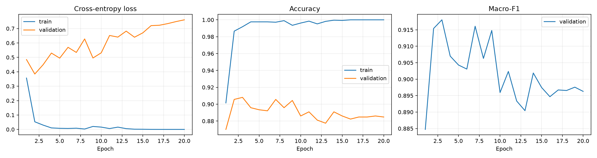

# UrbanSound8K 环境音频分类

从 Log-Mel + CNN 基线出发，实现以时间帧为 Token 的 Transformer，再适配 AudioSet 预训练 AST，比较全参数微调与冻结编码器、仅训练分类头的效果。项目包含音频预处理、训练验证、检查点恢复、误差分析与单条 WAV 预测。

最终选定 AST 全参数微调方案，在固定 Fold 10 测试集上得到 **Accuracy 89.61%、Macro-F1 90.46%**。这是一次固定划分的结果，不是 UrbanSound8K 官方十折交叉验证均值。

## 完成的工作

- 实现音频加载、单声道转换、重采样、定长裁剪/补零及 Log-Mel Dataset。
- 实现四个卷积块的 CNN，以及多头注意力、FFN、位置编码和两层 Encoder 组成的音频 Transformer。
- 比较原始 Log-Mel 与仅由训练集拟合的全局标准化；训练与验证使用同一组统计量。
- 复用 Transformers 的 AST 实现和预训练权重，适配十分类，支持混合精度、梯度累积、验证选优和独立评估。
- 比较 AST 全参数微调与仅训练分类头；核验冻结范围、参数更新、保存与恢复后的预测一致性。
- 保存逐条预测，结合混淆矩阵、频谱与试听分析错误；检查原始录音来源跨划分的风险。

AST 架构及预训练权重来自开源工作，本项目没有从头预训练 AST，也没有提出新的 Transformer 架构。

## 实验结果

Fold 1–8 训练（7079 条）、Fold 9 验证（816 条）、Fold 10 测试（837 条）。依据**验证 Macro-F1**保存和选择模型。

| 方案 | 初始化 / 输入 | 验证 Accuracy | 验证 Macro-F1 |
|---|---|---:|---:|
| CNN | 随机初始化，Log-Mel | 76.84% | 78.95% |
| 自建 Transformer E0 | 随机初始化，原始 Log-Mel | 64.58% | 67.82% |
| 自建 Transformer E1 | 随机初始化，训练集全局标准化 | 70.83% | 72.86% |
| AST E2：全参数微调 | AudioSet 预训练，配套 fbank | **90.81%** | **91.80%** |
| AST E3：仅分类头 | 相同预训练来源与 fbank | 85.66% | 87.46% |

E2、E3 使用相同 seed 42、学习率 `1e-5`、20 轮、物理 batch size 2、累积 16 次；最佳轮次分别为 3 和 19。该对照只比较这个学习率与预算下的冻结策略，不代表分别充分调参后的最佳能力。E3 可训练参数为 9,226，总参数仍为 86,196,490。

固定 E2 第 3 轮检查点后，在 Fold 10 测试一次：837 条中正确 750 条，Accuracy **89.61%**、Macro-F1 **90.46%**。没有根据本次测试结果追加调参。历史 CNN/E0 入口也执行过各自测试，因此不能声称整个项目从未查看其他测试结果。

精确数值与可重算的预测记录见 [实验报告](reports/README.md)。不同方案同时存在预训练、特征、规模和优化差异，不能把提升全部归因于架构。



## 完整数据流

```text
WAV → 单声道 → 16 kHz → 开头 4 秒 / 右侧补零 → [64000]
  ├─ CNN / 自建 Transformer：Log-Mel [1,64,126]
  │    ├─ CNN：四个卷积块 → 全局平均 → Linear(128,10)
  │    └─ Transformer：[126,64] → Linear(64,128) → 位置编码
  │                    → 两层 Encoder → 时间平均 → 十分类
  └─ AST：配套 fbank、补帧、固定标准化 → [1024,128]
           → 1212 个时频 Patch → 两个特殊 Token → 预训练 Encoder
           → 两个特殊 Token 表示取平均 → LayerNorm + Linear(768,10)
批处理后输出均为 logits [B,10]。
```

1024 包含特征补帧，不表示原始录音变长。AST 的特征计算与 CNN 不同，不能直接交换输入。

## 文件导航

| 文件 | 用途 |
|---|---|
| `audio_dataset.py` | CNN / 自建 Transformer 共用 Dataset |
| `train_cnn.py` | CNN、单轮训练、评估与训练入口 |
| `transformer_layers.py` | 手写多头注意力、FFN、位置编码、Encoder |
| `audio_transformer.py` | 音频 Transformer 与随机输入形状检查 |
| `train_audio_transformer.py` | E0 训练与检查入口 |
| `train_audio_transformer_normalized.py` | E1 统计量拟合与训练 |
| `train_ast.py` | AST 全参数/分类头训练、评估、预测 |
| `check_audio_data.py`、`inspect_log_mel.py` | 数据与预处理检查 |
| `visualize_audio_samples.py`、`analyze_cnn_validation.py` | 可视化、CNN 验证误差分析 |
| `compare_transformer_normalization.py` | 已有 E0/E1/CNN 实验比较 |
| `checks/` | 小样本集成检查；依赖和写入行为见下文 |
| `AST_README.md` | AST 配置、内部形状与使用细节 |
| `reports/` | 精简结果、逐条预测、曲线及指标复算脚本 |

## 环境与数据

1. 创建 Python 环境，按 [PyTorch 官方说明](https://pytorch.org/get-started/locally/)安装与设备匹配、版本配套的 PyTorch / TorchAudio；再执行 `python -m pip install -r requirements.txt`。
2. 从 [UrbanSound8K 官方页面](https://urbansounddataset.weebly.com/urbansound8k.html)自行取得数据，遵守数据许可与引用要求。仓库不分发原始音频。
3. 按下面结构放置数据，将所运行脚本的 `DATA_ROOT` 改为本机位置。主要入口默认 `D:/datasets/UrbanSound8K`；`inspect_log_mel.py` 沿用 `data/UrbanSound8K` 相对路径，也需检查。

```text
UrbanSound8K/
  metadata/UrbanSound8K.csv
  audio/fold1/*.wav
  ...
  audio/fold10/*.wav
```

依赖清单不等于跨平台锁定环境。实际实验版本见 [environment.json](reports/environment.json)，包含原环境已有的 PyTorch / TorchAudio 版本差异；这是运行记录，不是建议照抄的配套安装组合。本次未在全新环境重新安装验证，不保证跨设备、跨版本逐位复现。

## 运行

在项目根目录、激活 Python 环境后执行：

```powershell
# 不需要数据/权重：检查自建 Transformer 前向形状
python -B audio_transformer.py

# 不运行模型：从仓库保存的预测复算指标
python -B reports/verify_saved_results.py

# AST 全参数微调：会下载预训练权重并训练 20 轮
python train_ast.py

# AST 冻结编码器，仅训练分类头
python train_ast.py --finetune head

# 指定自己训练得到的运行目录，预测一条 WAV
python train_ast.py --predict "D:/my_audio.wav" --model-run "results/ast/你的运行目录"

# 重新评估已有实验的验证集
python train_ast.py --eval-run "results/ast/你的运行目录" --split validation
```

AST 首次下载约 350 MB。训练输出到独立时间戳目录，不自动测试；最终方案固定后才使用 `--split test` 独立评估。详见 [AST 说明](AST_README.md)。

仓库**不包含训练后的检查点**。省略 `--model-run` 时，预测默认指向作者本机历史目录，新克隆仓库没有该目录；请先训练并显式指定运行目录。恢复需要 `best_ast.pt`、`config.json`、`ast_config.json`、`preprocessor_config.json`。公开预测记录可以复算指标，不能代替权重预测新音频。

其他入口：`python train_cnn.py`、`python train_audio_transformer.py`、`python train_audio_transformer_normalized.py`。CNN/E0 训练后自动评估测试集，E1 不会。CNN 在当前目录保存 `best_cnn.pt` 和矩阵，会替换同名文件，重跑前请备份或使用独立工作目录；这里保留历史行为，不改变既有实验。

`checks/check_ast_pipeline.py` 和 `checks/check_train_audio_transformer_normalized.py` 会执行小样本训练并写独立检查目录，需要数据，AST 还需要预训练下载/缓存。`checks/check_ast_head_only.py` 额外依赖作者本地历史源码快照 `results/ast/20261019_101342_538523/train_ast.py`，用于重建旧初始化；该快照未发布，不能直接在全新克隆中运行此检查。历史比较脚本也需要相应实验目录。

## 限制与误差分析

- `fsID=180937` 跨训练与验证：训练 Fold 1 有 79 条 jackhammer，验证 Fold 9 有 16 条 drilling，部分元数据时间范围重叠。已记录来源风险，尚不能断定重复波形、标签错误或量化成绩偏高幅度。本地元数据未发现训练/测试或验证/测试 fsID 重叠，也不能排除其他重复或预训练数据重叠。
- 主要为单种子固定划分，未报告运行方差或十折均值。最佳权重选择不等于提前停止，AST 实际训练了 20 轮。
- 测试中 siren → dog_bark 有 20 条、drilling → street_music 有 13 条。混淆矩阵确定错误方向；声音线索导致错误的解释还需试听和进一步验证。
- 单条预测仅处理开头 4 秒，强制从十类选一类，不自动输出“未知”；无法据此检测整段长录音的全部事件。Softmax 分数不是预测正确率。

## 来源与致谢

- [UrbanSound8K](https://urbansounddataset.weebly.com/urbansound8k.html)：数据来源，请遵守官方许可与引用要求。
- [AST 论文](https://arxiv.org/abs/2104.01778)、[官方实现](https://github.com/YuanGongND/ast)。
- [预训练模型](https://huggingface.co/MIT/ast-finetuned-audioset-10-10-0.4593)，固定 revision `f826b80d28226b62986cc218e5cec390b1096902`。
- [Transformers AST 文档](https://huggingface.co/docs/transformers/model_doc/audio-spectrogram-transformer)：复用其模型及特征提取实现。

模型、数据与第三方库的许可分别以上游声明为准。本仓库未附带这些音频、预训练权重或依赖库。
